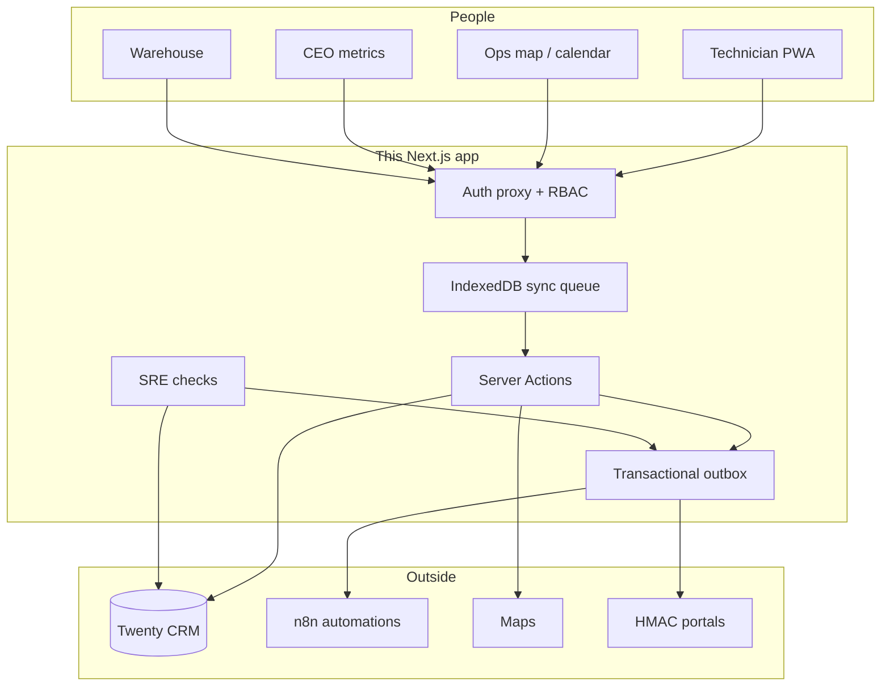

# Field operations platform for blinds installers

[](https://github.com/alyekseyenko/services-blinds/actions/workflows/ci.yml)


**Production software** (sanitized public copy). A multi-role PWA that runs the **field day** — agenda, millimetre measurements, warehouse prep, visit close — on top of **Twenty CRM**, even when the van has no signal.

UI copy is **Portuguese (Portugal)**. This README is English so a recruiter can read it in five minutes.

> No customer PII, no real company name, no production hosts or keys. Secrets live only in server `.env.local`.

---

## Why it exists (the business problem)

The company already sold in CRM. **Execution did not:** who is on site, what was measured, what is packed, when the install happens. That lived in WhatsApp, spreadsheets, and phone calls.

That gap is cash:

| Leak | What it costs |
|------|----------------|
| Technician types notes at night | Wrong millimetres → remakes and revisits |
| Warehouse discovers missing parts on install day | Van idle, customer delayed |
| Ops dispatches from a whiteboard | Slow routes, double-booked techs |
| CEO sees numbers at month-end | No live forecast, no ranking, no NPS loop |

This app is the **operations system of record**. CRM stays the commercial source of truth. n8n sends WhatsApp / PDF / email. The app owns scheduling, field work, warehouse, and executive metrics.

```
Lead → measure on site → warehouse prep → install → close visit → CRM stage + automation
```

Each hand-off is a typed Server Action plus an **outbox event** (idempotent). No dual-write from the browser.

---

## Who uses it (~20 people in production)

| Role | They open | Business effect |
|------|-----------|-----------------|
| **Technician** | `/dashboard` — day list, GPS, measurements, close visit **offline** | Work continues with no signal; fewer “I’ll type it tonight” errors |
| **Warehouse** | `/armazem` — per-item prep status + notes into CRM | Install day starts with material ready |
| **Ops (admin / member)** | `/admin` — map, calendar, mass schedule, history | Dispatch in minutes, not a phone round |
| **CEO** | `/ceo` — revenue, weighted forecast, win rate, km, rankings, feedback | Decisions from live data, not a spreadsheet |
| **Customer** | HMAC link — rate or cancel, no account | Less inbound admin; structured NPS into the pipeline |
| **SRE (strict admin)** | Observability — outbox, CRM breaker, sync telemetry | Automations fail visibly and can be retried |

---

## What this repo is meant to prove

Not a tutorial CRUD app. A **modular monolith** I designed, shipped, and operate.

| Bar | Evidence in this repo |
|-----|------------------------|
| **Product sense** | Roles, stages, and cash-flow path are explicit — not a generic “task list” |
| **Reliability** | IndexedDB queue (retries, multi-tab lock, telemetry) + transactional outbox to n8n |
| **Integration** | Twenty GraphQL with timeouts, retries, **circuit breaker**; CRM field names live in one contract |
| **Security** | JWT + RBAC (`proxy.ts` + actions), HMAC public portals, **no CRM writes from client bundles** |
| **Maintainability** | Domain folders + **600-line CI ratchet** — **zero god files** in `src/` |
| **Judgement** | Microservices were rejected on purpose (team size, deploy risk). ADRs document why. |

**Stack:** Next.js 16 · React 19 · TypeScript · Zod · Tailwind v4 · Dexie · NextAuth · Postgres (measurements) · Redis (optional) · Docker · Vitest (640+) · Playwright · GitHub Actions.

---

## Eight-minute walkthrough (open these)

If you only read code, start here:

| Minutes | Open | Why |
|---------|------|-----|
| 1 | [`src/lib/crm/contract.ts`](src/lib/crm/contract.ts) | Domain: stages, task status, roles — UI never hardcodes Twenty strings |
| 2 | [`src/lib/crm/pipelineTransitions.ts`](src/lib/crm/pipelineTransitions.ts) | Funnel writes have **one gateway** (`EM_CURSO` must not move the pipeline) |
| 2 | [`src/lib/sync/syncQueueEnqueue.ts`](src/lib/sync/syncQueueEnqueue.ts) | Offline-first: try online under a lock, else IndexedDB |
| 1 | [`src/lib/outboxQueue.ts`](src/lib/outboxQueue.ts) + [`src/lib/integrations/outboxEvents.ts`](src/lib/integrations/outboxEvents.ts) | CRM commit ≠ WhatsApp send; idempotency + schema version |
| 1 | [`src/lib/ceo/aggregators.ts`](src/lib/ceo/aggregators.ts) | Pure finance / ranking / warehouse stats — testable without GraphQL |
| 1 | [`src/lib/__tests__/fileSizeFitness.test.ts`](src/lib/__tests__/fileSizeFitness.test.ts) | Fitness function: new files cannot exceed 600 lines |
| — | [`docs/adrs/`](docs/adrs/) | Decisions, not folklore |

Then skim [`docs/END_TO_END_BUSINESS_FLOW.md`](docs/END_TO_END_BUSINESS_FLOW.md) if you want CRM stage → field → automation in one page.

---

## How the system is shaped



**Ownership**

| System | Owns |
|--------|------|
| Twenty | Accounts, commercial pipeline, proposals, payments |
| This app | Agenda, measurements, warehouse, CEO analytics, public portals |
| n8n | WhatsApp, email, PDF, Drive |

**Choices that matter (and why)**

- **Offline queue on the device** — field signal is unreliable; failed sync is visible, not silent ([ADR 002](docs/adrs/002-offline-queue.md)).
- **Server Actions as use cases** — `{ success, data?, error? }`; GraphQL only in `src/lib/crm/*` (`server-only`).
- **Outbox instead of dual-write** — persist in CRM, then notify n8n with retries and dead-letter.
- **HMAC portals** — rating / cancel without login; tokens expire and are scoped ([ADR 003](docs/adrs/003-public-portal-tokens.md)).
- **Stage-first visits** — type comes from CRM stage + title, not a second “service type” field that drifts.

**What we accepted:** eventual consistency with CRM; **one app instance** today (shared Redis/DB if we ever scale out); commercial rules stay in CRM+n8n, operational rules in this app.

**What we refused:** microservices for ~20 users; a plugin kernel inside the app (n8n already is that); client-side CRM mutations.

Full trade-offs: [ADR 004](docs/adrs/004-architecture-characteristics.md).

---

## Layout

```
src/
├── actions/           # Authorized use cases (Server Actions)
├── app/               # dashboard, admin, ceo, armazem, HMAC portals, API
├── components/        # UI by domain
├── lib/
│   ├── agenda/        # In-app bell / diffs (ops, not browser push)
│   ├── ceo/           # Metrics: CRM queries + pure aggregators
│   ├── crm/           # GraphQL, contract, opportunities (stage writes gated)
│   ├── measurements/  # Postgres repo + admin use cases
│   ├── observability/ # SRE registry
│   ├── sync/          # Offline enqueue / retry / runtime
│   └── visits/        # Close visit, on-site extras, timings
└── proxy.ts           # Next.js 16 auth + RBAC
docs/adrs/
```

UI cannot import `@/lib/crm/client` (`npm run lint:boundaries`).

---

## Run it locally

Node **22**. You need a Twenty workspace (or a stub URL) and `.env.local` from [`.env.example`](.env.example). CI does **not** need production secrets.

```bash
git clone https://github.com/alyekseyenko/services-blinds.git
cd services-blinds
npm install
cp .env.example .env.local
npm run dev
```

| Command | What it proves |
|---------|----------------|
| `npm run validate` | `tsc` + Vitest + boundary lint |
| `npm run test:e2e:smoke` | Playwright login smoke |
| `npm run build` | Production compile |

There is **no public live demo** (real customers). Review CI + this README + the files above.

---

## More depth (optional)

| Doc | When to open it |
|-----|-----------------|
| [END_TO_END_BUSINESS_FLOW.md](docs/END_TO_END_BUSINESS_FLOW.md) | Stage machine across CRM, field, n8n |
| [ARCHITECTURE_MASTER_BLUEPRINT.md](ARCHITECTURE_MASTER_BLUEPRINT.md) | Long-form design |
| [E2E_OBSERVABILITY_SUITE.md](docs/E2E_OBSERVABILITY_SUITE.md) | How we know automations still work |
| [DESIGN_SYSTEM.md](DESIGN_SYSTEM.md) | Outdoor PWA UX (48px targets, contrast) |
| [DEPLOY_HETZNER.md](DEPLOY_HETZNER.md) | Docker / VPS pattern (no real IPs) |
| [AGENTS.md](AGENTS.md) | How the codebase is supposed to grow |

---

## Security

- Never commit `.env.local`, keys, or production URLs.
- This GitHub copy uses placeholders (`yourcompany.com`). Deploy scripts stay gitignored.
- Internal ops notes are not a live incident log.

## License

All rights reserved — portfolio / demonstration source. Not licensed for commercial reuse without permission.
